  
  
  
  

  <b>3 years shipping AI in manufacturing</b>, where a wrong call costs real money 
  and engineers have to trust the output. Now bringing that discipline to LLM and agent deployments.

## 🏭 From discovery to adoption

I take predictive models from the first conversation to daily use on the factory floor. A model only counts once the people responsible for the outcome act on it.

## 🛠️ Selected projects

<table>
<tr>
<td width="50%" valign="top">

### [Configent](https://github.com/shaokiat/configent)
Turns a client's documents or database into an assistant that cites its sources and says when it can't answer.

**Weeks → under an hour** from "prospect has documents" to a branded demo. A new client is one YAML file plus a sources folder.

`LangGraph` `Python` `RAG`

</td>
<td width="50%" valign="top">

### [Timestral-PdM](https://github.com/shaokiat/timestral-pdm)
Can a zero-shot foundation model replace per-machine ML for fault detection? Benchmarked against a rolling z-score and LightGBM on SKAB pump data.

**Verdict: not a suitable replacement.** The honest answer is the useful one.

`Timestral` `LightGBM` `Python`

</td>
</tr>
</table>

<b>More projects</b>

 

- **[agentic-cookbook](https://github.com/shaokiat/agentic-cookbook):** agent patterns (ReAct, plan-and-execute, multi-agent, memory) built without heavy abstractions, so each one can be read end to end.
- **[theta-agent](https://github.com/shaokiat/theta-agent):** CLI agent that researches a ticker and suggests an options strategy through conversation with Claude.
- **[Tilt Tamer](https://shaokiat.github.io/tilt-tamer/):** preflop poker trainer for drilling open-raise decisions.

## 🧰 Toolkit

**Predictive & CV** 

**LLMs & agents** 

**Deployment** 

---

GCP Professional Cloud Architect · Teaching responsible AI literacy in Singapore

